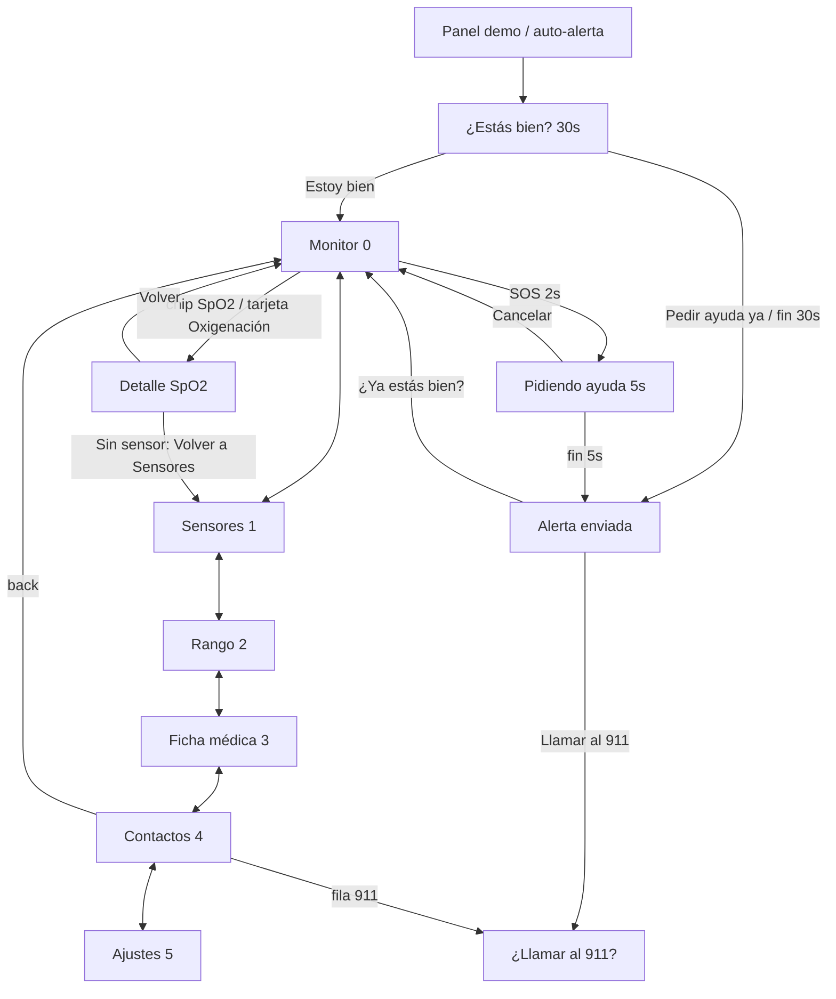

# UI_SPEC — Especificación exacta para reimplementar la app en ArkTS (ArkUI)

Fuente única de verdad: `src/App.tsx` (lógica, textos, estado) y `src/index.css` (tokens, medidas, animaciones). **Todos los valores están copiados literalmente del código**. No se estiman ni se "corrigen".

## 0. Convenciones y correspondencia ArkUI

| Concepto CSS | Valor literal | Equivalente sobre el reloj | Nota ArkUI |
|---|---|---|---|
| Reloj | `width: 466px; height: 466px` | 466 × 466 | `Stack` raíz de `466 vp` |
| `1cqw` | `container-type: size` sobre `.watch-frame` | `466 / 100 = 4,66 px` exactos | `vp = cqw × 4,66 / 100` |
| `%` en hijos directos | relativo a 466 px | `466 × % / 100` | igual en ArkUI |
| `rem` | `0.0625rem = 1px`, `0.44rem = 7,04px` | root `font-size: 16px` | usar `vp` |
| Escalado externo | `computeWatchScale = max(0.25, min(1, (w-28)/466, (h-28)/466))` | `VIEWPORT_MARGIN = 28`, `WATCH_SIZE = 466` | `scale` uniforme del `Stack` |
| Fuente | `"Roboto", system-ui, -apple-system, sans-serif` (wght 400/500/600/700) | — | cargar Roboto |

Regla de oro: **todo lo interior se mide en `cqw` o `%`**; los únicos px "duros" son botones de 48/52 px, anillos SVG, la cabecera de 32 px/260 px y los degradados de 24 px.

---

## 1. Inventario de pantallas y mapa de navegación

### 1.1 Pantallas base (`page-track`, `translateY(-activePage * 100%)`)

| Índice | `PageId` | Etiqueta | Cómo se llega | Cómo se sale |
|---|---|---|---|---|
| 0 | `monitor` | `Monitor` | Estado inicial; indicator; swipe derecha (`deltaX > 60`); botón regresar de Contactos | indicator; swipe vertical; botón Contactos (`setActivePage(4)`); SOS; alerta |
| 1 | `sensors` | `Sensores` | indicator; swipe arriba (`deltaY < -45`) | indicator; swipe abajo/arriba; Swipe derecha → -1 |
| 2 | `range` | `Tu rango normal` | indicator; swipe vertical | indicator; swipe vertical |
| 3 | `medical` | `Ficha médica` | indicator; swipe vertical | indicator; swipe vertical |
| 4 | `contacts` | `Contactos` | indicator; swipe vertical; **botón circular de Contactos del Monitor** (`setActivePage(4)`) | indicator; swipe; **`WatchBackButton` → `setActivePage(0)`** |
| 5 | `settings` | `Ajustes` | indicator; swipe arriba | indicator; swipe abajo |

El track tiene `transition: transform 360ms cubic-bezier(0.22, 0.8, 0.32, 1)`. El indicador lateral usa los ángulos `[-27.5, -16.5, -5.5, 5.5, 16.5, 27.5]` grados y se oculta cuando `dialogOpen === true`.

### 1.2 Pantallas de detalle / overlays (fuera del track)

| Pantalla | Se abre con | Se cierra con | z-index |
|---|---|---|---|
| Detalle SpO₂ (`activeDetail === "spo2"`) | chip SpO₂ del Monitor; tarjeta Oxigenación de Sensores; botones del panel demo | `WatchBackButton` → `closeSpo2Detail()`; en variante sin sensor, "Volver a Sensores" → close + `setActivePage(1)`; swipe derecha `deltaX > 55` | 15 |
| `¿Estás bien?` (`alertState === "are-you-ok"`) | auto-alerta tras 3 s; "Simular alerta" (motivo ≠ `sos-manual`); "Pedir ayuda" en SpO₂ muy bajo | "Estoy bien" → toast; "Pedir ayuda ya" → Alerta enviada; cuenta 30 s → Alerta enviada | 20 |
| `Pidiendo ayuda` (`alertState === "sos-countdown"`) | SOS del Monitor (mantener 2 s); "Simular alerta" con motivo `sos-manual` | "Cancelar" → none; cuenta 5 s → Alerta enviada | 20 |
| `Alerta enviada` (`alertState === "alert-sent"`) | fin de cuenta de las dos pantallas anteriores; botón demo "Ver Alerta enviada" | "Cancelar alerta" → diálogo → confirmación; "Llamar al 911" → diálogo (no cierra la pantalla) | 20 |
| Modal "Elige desde tu teléfono" (Contactos) | "Añadir" (si < 5) | "Cancelar" | 30 |
| Diálogo "¿Quitar contacto?" | pulsación larga de 600 ms sobre un contacto | "Quitar" / "Cancelar" | 30 |
| Diálogo "¿Llamar al 911?" | fila fija 911 (Contactos) y botón "Llamar al 911" (Alerta enviada) | "Llamar" / "Cancelar" | 30 |
| Diálogo "¿Ya estás bien?" | "Cancelar alerta" en Alerta enviada | "Sí, estoy bien" / "Volver" | 30 |
| Modal "Elige desde tu teléfono" (Alerta enviada, sin contactos) | "Añadir contacto" | "Entendido" | 30 |
| Píldora "Llamando a …" | botón verde de llamar de un contacto | desaparece sola tras 2500 ms | 25 |
| Toast "Alerta cancelada" / "Avisamos a tus contactos" | confirmaciones de cancelación | desaparece solo tras 2000 ms | 25 |
| Píldora "Sin conexión" | `mode === "offline"` | cambio de modo | 8 |

### 1.3 Grafo



**Gestos (en `.watch-frame`)**: se registran solo si `alertState === "none" && !dialogOpen` y el `pointerdown` no proviene de `button, [role='button'], input, label, .sensor-list-card, .sensor-chip, .contact-item-row`. Al soltar: `deltaX > 60 && |dx| > |dy|` → página −1; `|dy| > 45 && |dy| > |dx|` → página +1 si `dy < 0`, −1 si `dy > 0` (ambos acotados a `[0, 5]`). Con detalle SpO₂ abierto, `deltaX > 55` lo cierra.

---

## 2. Tokens

### 2.1 Colores (literales de `:root` y `.watch-frame`)

| Token | Valor |
|---|---|
| `--color-accion-principal` | `#ff3b30` |
| `--color-red` | `var(--color-accion-principal)` |
| `--color-green` | `#34c759` |
| `--color-orange` | `#ff9500` |
| `--color-blue` | `#32ade6` |
| `--color-card` | `#1c1c1e` |
| `--color-border` | `#2c2c2e` |
| `--color-muted` | `#8e8e93` |
| `:root color` | `#ffffff` |
| `:root background` | `#101012` |
| `.app-shell background` | `radial-gradient(circle at 50% 45%, #29292d 0, #171719 34%, #0c0c0d 75%)` |
| `.watch-frame background` | `#000000` |
| Otras grises usadas | `#242426`, `#070707`, `#171719`, `#1c1c1e`, `#242428`, `#2a2a2e`, `#2c2c34`, `#3a3a3c`, `#3a3a40`, `#48484e`, `#48484c`, `#636366`, `#8e8e93`, `#a1a1aa`, `#d1d1d6`, `#e5e5ea`, `#f2f2f7`, `#141416`, `#0d0d10`, `#08080a`, `#3a1513` |

Colores de estado en `monitorVariants` y helpers:

| Variante | `bpm` | `label` | `color` | `markerAngle` | `movement` | `spo2Num` / `spo2` | `tempNum` / `temp` | `next` |
|---|---|---|---|---|---|---|---|---|
| `normal` | 78 | `Ritmo normal` | `#34C759` | 245 | `Caminando` / `#34C759` | 98 / `98%` | 36.5 / `36.5°C` | `elevated` |
| `elevated` | 104 | `Pulso elevado` | `#FF9500` | 295 | `En reposo` / `#FF9500` | 93 / `93%` | 37.4 / `37.4°C` | `critical` |
| `critical` | 132 | `Revisa tu estado` | `#FF3B30` | 346 | `Inmóvil` / `#FF3B30` | 88 / `88%` | 38.6 / `38.6°C` | `normal` |

Segmentos del gauge: `{`#32ADE6`, 170→216}`, `{`#34C759`, 222→267}`, `{`#FF9500`, 273→318}`, `{`#FF3B30`, 324→370}`.

### 2.2 Tipografía (sobre 466 px; `1cqw = 4,66 px`)

| Token / selector | Valor literal | px exactos |
|---|---|---|
| `--fs-hero` | `16.3cqw` | 75,958 |
| `--fs-subtitle` | `5.8cqw` | 27,028 |
| `--fs-body` | `4.85cqw` | 22,601 |
| `--fs-label` | `4.35cqw` | 20,271 |
| `--touch-min` | `10.35cqw` | 48,231 |
| `.bpm-value.is-three-digit` | `13.7cqw` | 63,842 |
| `.spo2-percentage-number` | `13.7cqw` / `12cqw` (3 dígitos) | 63,842 / 55,92 |
| `.countdown-number` | `14cqw` | 65,24 |
| `.countdown-unit` | `20px` | 20 |
| `.range-hero-value` | `13.4cqw` | 62,444 |
| `.sensor-value` | `6.2cqw` | 28,892 |
| `.sensor-value.is-text` | `4cqw` | 18,64 |
| `.sensor-value.is-unavailable` | `4.8cqw` | 22,368 |
| `.sensor-value.is-permission` | `3.8cqw` | 17,708 |
| `.sensor-state-pill` | `2.95cqw` / `3cqw` (permiso) | 13,747 / 13,98 |
| `.sensors-unavailable-label` | `3.1cqw` | 14,446 |
| `.watch-offline-pill` | `3.3cqw` | 15,378 |
| `.watch-toast-cancelled` | `3.6cqw` | 16,776 |
| `.contact-avatar-bubble` | `3.8cqw` | 17,708 |
| `.medical-row-card strong` | `4.6cqw` | 21,436 |
| `.setting-cycle-badge` | `4.6cqw` | 21,436 |
| `.alert-confirm-dialog-card h3` | `6cqw` | 27,96 |
| `.are-you-ok-header h2` | `6cqw` | 27,96 |
| `.alert-sent-header h2` | `5.2cqw` | 24,232 |

> Nota de cascada exacta: `.range-current-badge` aparece dos veces. La regla posterior (`línea 2122`) gana: `margin-top: 3cqw; font-size: var(--fs-label); font-weight: 600`, conservando `line-height: 1.1` de la primera. Por tanto el valor efectivo es **4,35cqw / 20,271 px**, no 4,9cqw.

Pesos: `400` en secundarios, `500` en guía/count, `600` en etiquetas y valores, `700` en cifras y botones. `letter-spacing`: `-0.04em` en cifras grandes, `0.03em` en `.live-label`, `0.08em` en `.bpm-label`, `-0.02em` en `.are-you-ok-header h2`, `-0.06em` en `.alert-offline-banner`, `-0.03em` en `.alert-empty-contacts`.

### 2.3 Espaciados y radios

| Elemento | Medida literal |
|---|---|
| Zona segura | `--safe-block: 14%` (65,24 px arriba/abajo), `--safe-inline: 9%` (41,94 px lados) |
| Standard page | `gap: 2.8cqw` |
| Cabecera estándar | `width: 64cqw; min-height: 7.4cqw; gap: 1.8cqw` |
| Botón principal compartido | `width: 70%; min-height: 52px; border-radius: 999rem; font-size: var(--fs-body); font-weight: 700` |
| Botón secundario compartido | `background: rgba(255,255,255,0.08); border: 0.0625rem solid #48484e` |
| Botón deshabilitado | `background: #3a3a3c; color: #a1a1aa` |
| `.info-card` | `border: 0.0625rem solid var(--color-border); border-radius: 4.2cqw` |
| `.line-icon` | `5.6cqw × 5.6cqw`, `stroke-width: 2` |
| Botón regresar | `top: 15%; left: 13%; 48px × 48px; border-radius: 50%; z-index: 20` |
| Scrolls (ficha/contactos/ajustes) | `width: 74cqw / 76cqw / 74cqw; max-height: 63cqw; scrollbar-width: none` |
| Degradados 24 px | `.sensors-scroll-wrap`, `.medical-scroll-container`, `.alert-sent-content-scroll`: `transparent 0, #000 24px, #000 calc(100% - 24px), transparent 100%` |
| Radios de tarjetas | `3.6cqw` (sensor chip / métricas), `3.8cqw` (contacto alerta), `4cqw` (contacto, ficha, ajustes), `4.2cqw` (info-card), `4.6cqw` (tarjeta sensores) |
| Píldoras | `border-radius: 999rem` |
| Bordes finos | `0.0625rem` (= 1 px) |

### 2.4 Glows y sombras (literales)

| Elemento | Sombra / filtro |
|---|---|
| `.watch-frame` | `0 0 0 0.44rem #242426, 0 0 0 0.56rem #070707, 0 1.5rem 4.4rem rgb(0 0 0 / 65%)` |
| `.live-label span` | `0 0 1.6cqw rgb(255 59 48 / 80%)`; offline `rgba(255,149,0,0.8)` |
| `.gauge-state-ring`, `.gauge-marker` | `drop-shadow(0 0 1cqw var(--state-color))` |
| `.ecg-line path` | `drop-shadow(0 0 0.6cqw var(--state-color))` |
| `.heart-status span` | `text-shadow: 0 0 1.8cqw color-mix(in srgb, var(--state-color) 40%, transparent)` |
| `.sos-button-inner` | `0 0.8cqw 3cqw rgb(255 59 48 / 28%)` |
| `.monitor-page.is-critical .sos-button-inner` | animación `0 0.8cqw 3cqw 28%` → `0 0.8cqw 5cqw 65%` |
| `.contact-call-green-btn`, `.emergency-call-red-btn` | `0 0.5cqw 1.8cqw rgba(52,199,89,0.35)` / `rgba(255,59,48,0.35)` |
| `.monitor-exercise-badge` | `rgba(52,199,89,0.14)`, borde `rgba(52,199,89,0.35)` |
| `.range-curved-highlight` | `drop-shadow(0 0 6px rgba(52,199,89,0.35))` |
| `.range-curved-marker` | `drop-shadow(0 0 5px currentColor)` |
| `.page-indicator button.active span` | `0 0 1.4cqw rgb(255 255 255 / 40%)` |
| `.alert-pulsing-dot` | `0 0 6px #32ade6` / `0 0 6px var(--color-orange)` |
| `.alert-sent-check-circle` | `0 0 1.4cqw rgba(52,199,89,0.4)` / `rgba(255,149,0,0.4)` |
| Countdown progreso | `drop-shadow(0 0 6px rgba(255,59,48,0.6))`; `¿Estás bien?` blanco `0.75`; crítico rojo `0.7` |
| `.btn-im-fine` / `.btn-help-now` | `0 0.8cqw 2.4cqw rgba(52,199,89,0.4)` / `rgba(255,59,48,0.4)` |
| `.watch-toast-cancelled`, `.watch-calling-pill` | `0 1cqw 3cqw rgba(0,0,0,0.55)` / `0.6` |
| `.sos-alert-icon` | `0 0 4.8cqw rgb(255 59 48 / 40%)` |
| Overlay SOS / `¿Estás bien?` | halo `radial-gradient(...)` + `inset 0 0 38px / 68px rgba(255,59,48,0.18 / 0.32)` |
| **Confirmaciones** | overlay `background: #000000; backdrop-filter: none` (sin blur ni manchas); icono `background: transparent` |

### 2.5 Duraciones y curvas

| Valor | Dónde |
|---|---|
| `360ms cubic-bezier(0.22, 0.8, 0.32, 1)` | `.page-track` transform |
| `400ms cubic-bezier(0.2, 0.8, 0.2, 1)` | `.range-curved-marker` (all) |
| `950ms linear` | `.countdown-ring-progress` stroke-dashoffset |
| `950ms linear` + `300ms ease` | `.spo2-ring-progress.is-measuring` |
| `450ms ease` + `300ms ease` | `.spo2-ring-progress` normal |
| `200ms ease-out` | `reveal` en modal, offline pill, confirmaciones |
| `220ms ease-out` | `reveal` en SpO₂ y overlay SOS |
| `240ms ease-out` | `reveal` en Alerta enviada |
| `200ms cubic-bezier(0.16, 1, 0.3, 1)` | `demo-panel-reveal` |
| `240ms cubic-bezier(0.16, 1, 0.3, 1)` | toast de cancelación |
| `180ms ease` | toggles, indicador, tarjetas sensores |
| `120ms ease` | transform en tarjetas/botones (scale 0.98 / 0.97 / 0.92) |
| `150ms ease` | pill de permiso, botones secundarios |
| `2000ms` | SOS mantener; toast; píldora llamada |
| `600ms` | pulsación larga para quitar contacto |
| `2600ms` | aviso de permiso en Sensores |
| `1600ms` | feedback "Vibración enviada" en Ajustes |
| `3000ms` | auto-alerta |

---

## 3. Especificación por pantalla

### 3.1 Monitor (`is-${variant}`, `--state-color`)

```
section.watch-page.monitor-page  [padding 14% 9%; justify-content: space-between]
├─ toast.watch-toast-cancelled                    ← solo si toastMessage
├─ div.monitor-status-line [width 76cqw; gap 1.6cqw]
│  ├─ p.live-label [max 50cqw; 4.35cqw; 600; letter .03em]
│  │  └─ span [1.9cqw círculo, glow]
│  └─ span.monitor-exercise-badge                 ← solo si exerciseMode
├─ HeartRateGauge
├─ button.heart-status [max 74cqw; min-h 5.6cqw; gap 2cqw; --fs-body]
│  ├─ span  ← "Calibrando..." | state.label
│  └─ small ← "Espera" | "Ahora"
├─ div.monitor-chips [width 66cqw; gap 1.5cqw]
│  ├─ button.sensor-chip [height 11.8cqw]  SpO₂
│  └─ div.sensor-chip                       Movimiento
└─ div.monitor-actions [height --touch-min; gap 2.6cqw]
   ├─ SosButton  [34cqw × 10.35cqw; "SOS" + "2s"]
   └─ button.contacts-icon-button [10.35cqw círculo]
```

**Textos exactos**: `PRIMER USO · CALIBRANDO` / `SIN CONEXIÓN · MODO LOCAL` / `MEDICIÓN EN VIVO`; `Ejercicio`; `BPM`; `Ritmo normal` / `Pulso elevado` / `Revisa tu estado` / `Calibrando...`; `Ahora` / `Espera`; `SpO₂`; `Movimiento`; `98%` / `93%` / `88%` / `--` / `—`; `Caminando` / `En reposo` / `Inmóvil` / `Calibrando`; `SOS`; `2s`.

**Gauge** (`HeartRateGauge`): SVG `viewBox="0 0 270 154"`, `cx=135 cy=126`, radio exterior `123`, interior `108`, arco `170→370`; marcador `r="6.5"` en `markerAngle` (o `170` en primer uso). Anillo de estado `stroke-width: 3`, pista `12`. Contenido `top 23% right 12% bottom -1% left 12%`; ECG `viewBox="0 0 150 26"` con `pathLength={100}` y path `M2 14h26l7-2 7-10 10 21 10-17 8 8h20l6-2 6-7 8 15 8-6h30`.

**Variantes**:

| Condición | Efecto |
|---|---|
| `mode === "first-use"` | `is-first-use`: `--state-color: #8e8e93`, segments `opacity: 0.3`, bpm `--`, SpO₂ `--`, movimiento `Calibrando` (gris), etiqueta `PRIMER USO · CALIBRANDO`, heart-status no cambia de variante |
| `mode === "offline"` | texto `SIN CONEXIÓN · MODO LOCAL`, punto naranja, píldora global "Sin conexión" |
| `variant === "critical"` | ECG `opacity: 1` + `ecg-sweep 1.6s`, SOS `sos-glow-pulse` |
| `variant === "elevated"` | ECG `opacity: 0.8` |
| `sensitivity` + `exerciseMode` | umbral de auto-alerta (§6); badge `Ejercicio` |
| `toastMessage` | píldora verde arriba (`top: 11cqw`) |

### 3.2 Sensores

```
section.watch-page.sensors-page [padding: 0]
├─ div.sensors-header-fixed [padding: 14% 9% 0] → PageHeader "Sensores"
├─ div.sensors-scroll-wrap [flex:1; margin-bottom 2.6cqw; degradados 24px]
│  └─ div.sensors-scroll-container [padding 24px 9%; gap 2.2cqw]
│     ├─ div.sensors-vertical-list [width 72cqw; margin-right 4cqw; gap 2.2cqw]
│     │  └─ SensorCardItem × N
│     └─ si faltan sensores: p "No disponibles en tu reloj" + segunda lista
└─ div.sensors-permission-notice                 ← 2600 ms tras "Activar"
```

Tarjeta: `min-height 19cqw`, `padding 2.4cqw 3.2cqw`, `border-radius 4.6cqw`; icono `7.6cqw` círculo (`4.4cqw` glyph); valor `6.2cqw`; pill `2.95cqw`.

**Tarjetas y textos**: `Ritmo cardiaco` (`{bpm} BPM`, estado `Normal`/`Pulso elevado`/`Revisa tu estado`), `Oxigenación` (`98%`/`93%`/`88%`, `Normal`/`Baja`/`Muy baja`), `Temperatura` (`36.5°C`/`37.4°C`/`38.6°C`, `Estable`/`Elevada`/`Fiebre`), `Movimiento` (`Caminando`/`En reposo`/`Inmóvil`, mismo estado que pulso), `Ubicación` (`Señal precisa`, `Se comparte en alertas`). Etiquetas de variante: `Sin lectura`, `--`, `No disponible`, `Activar`, `No disponibles en tu reloj`, `Permiso solicitado · Actívalo en tu teléfono`.

**Variantes** (`getCardVariant(hasHardware)`):
1. `!hasHardware` → `unavailable` (opacidad 0,4, borde `rgba(255,255,255,0.06)`, `--`, "No disponible").
2. `sensorMode === "permission"` → `permission` (borde naranja, "Sin lectura" + botón "Activar").
3. `sensorMode === "measuring" || mode === "first-use"` → `measuring` (skeleton `1.5s`).
4. En otro caso → `active` (valor real + pill de tono).

Solo SpO₂ activa es clickable → detalle. Cards no equipadas se agrupan bajo "No disponibles en tu reloj".

### 3.3 Detalle SpO₂

```
div.spo2-detail-screen.is-${screenState} [absolute; z15; padding 14% 9%; gap 1.2cqw; reveal 220ms]
├─ WatchBackButton ("Volver")
├─ header.spo2-screen-header → h2 "Oxigenación"
├─ div.spo2-ring-container [40cqw × 40cqw]
│  ├─ svg viewBox 0 0 160 160, rotate(-90), r=72, strokeWidth=10
│  └─ div.spo2-ring-content → número + badge | countdown | icono error
└─ div.spo2-actions-area [width 70cqw; gap 1cqw]
```

Resultados: `optimal {98, #34C759, "Óptimo"}`, `low {92, #FF9500, "Bajo"}`, `very-low {88, #FF3B30, "Muy bajo"}`. Color del anillo: `>=95` verde, `>=90` naranja, `<90` rojo. `strokeDashoffset = 2π·72 − (2π·72 · progress)/100`; en `measuring`, `progress = ((30−countdown)/30)·100`.

**Textos por estado**:
- `idle`: `Última medición · hace 12 min` + `Medir ahora`.
- `measuring`: `{countdown}` + `segundos`; guía `Quédate quieto` (azul) o `Movimiento detectado: quédate quieto` (naranja); `Cancelar`.
- `result`: guía según resultado — `Medición completada · Ahora`, `Un poco bajo. Vuelve a medir`, `Si sientes falta de aire, pide ayuda` + `Pedir ayuda` (solo very-low); siempre `Medir de nuevo`.
- `error`: `No se pudo medir`, `Ajusta el reloj y mantén el brazo quieto`, `Reintentar`.
- Sin sensor (`config.spo2 === false`): `Tu reloj no mide oxigenación`, `Este modelo no tiene sensor de oxígeno`, `Volver a Sensores`.

Botones: `52px` de alto, `border-radius: 999rem`, `font-size: var(--fs-body)`.

### 3.4 Tu rango normal

```
section.watch-page.standard-page.range-page-wrapper [gap 1.5cqw]
├─ PageHeader "Tu rango normal"
└─ div.range-main-content [width 74cqw; flex:1; gap 1.6cqw; centrado]
   ├─ p.range-condition-label
   ├─ div.range-hero-numbers [gap 1.5cqw] → strong + span
   ├─ div.range-curved-bar-container [66cqw × 17cqw]
   │  └─ svg viewBox 0 0 240 70: track "M 20 52 Q 120 16 220 52" strokeWidth 9;
   │     highlight strokeWidth 11; marker-shadow r 7.5; marker r 6
   └─ div.range-status-box
```

Curva: `P0(20,52) Q(120,16) P2(220,52)`; espectro `minBpm = 40`, `maxBpm = 160`; `ratioFor = clamp((bpm−40)/120, 0.02, 0.98)`; subcurva del rango por subdivisión de Bézier (`highlightPath()`). Marcador = `curvePoint(currentBpm)`, color `variant.color` (gris `#8e8e93` en primer uso).

| Condición | Textos |
|---|---|
| Normal | `En reposo`, `58-92`, `BPM`, `Pulso actual: {bpm} BPM`, `Pulso en reposo: 64 BPM`, `Aprendido de tus últimos 7 días` |
| `mode === "first-use"` | `Aprendiendo tu ritmo`, `60-100`, `BPM (general)`, `Faltan 5 días`, `Rango general 60-100 BPM` |

El highlight usa `.is-out` (`opacity: 0.75`) cuando el pulso está fuera del rango.

### 3.5 Ficha médica

```
section.watch-page.standard-page.medical-page-wrapper [gap 1.5cqw]
├─ PageHeader "Ficha médica"
└─ div.medical-scroll-container [74cqw; max-h 63cqw; padding 24px 0; degradado 24px]
   ├─ vacío → div.medical-empty-view
   └─ datos → div.medical-cards-stack [gap 1.8cqw] → 4 × div.medical-row-card
```

Cada tarjeta (columna): `.medical-row-label` (icono `4.4cqw` + texto gris `4.35cqw`) arriba; `strong` blanco `4.6cqw`, `line-height 1.15`, `white-space: normal`, `overflow-wrap: anywhere` abajo. `min-height 16cqw`, `gap 1.2cqw`, `padding 2.4cqw 3.6cqw`, `border-radius 4cqw`.

| Icono | Etiqueta | Valor |
|---|---|---|
| `heart` | `Tipo de sangre` | `O+` (`.medical-val-highlight`, 700) |
| `warning` | `Alergias` | `Penicilina, mariscos` |
| `pill` | `Medicamentos` | `Enalapril 10 mg · 1 tableta al día` |
| `shield` | `Condiciones` | `Hipertensión arterial` |

**Vacío** (`config.medicalEmpty || mode === "first-use"`): icono `smartphone` (`12cqw` burbuja / `6.5cqw`), `Complétala en tu teléfono`, `Abre la aplicación de salud en tu teléfono para registrar tu grupo sanguíneo, alergias y medicamentos.`, botón `Simular datos` → `update({ medicalEmpty: false })`.

### 3.6 Contactos

```
section.watch-page.contacts-page-wrapper [padding 14% 9%; gap 1cqw]
├─ WatchBackButton [top 15%; left 13%; 48px] → Monitor
├─ div.contacts-top-bar [76cqw; min-h 11cqw] → PageHeader "Contactos"
├─ div.contacts-scroll-area [76cqw; max-h 63cqw]
│  ├─ vacío → div.contacts-empty-state
│  │  ├─ empty-icon-bubble (user) 12cqw
│  │  ├─ strong "Aún no tienes contactos"
│  │  ├─ span "Añade a alguien de confianza"
│  │  └─ primary-button "Añadir"
│  ├─ datos → div.contacts-list-container
│  │  ├─ article.contact-item-row × N [min-h 16cqw] → avatar + nombre/rol + botón verde
│  │  └─ primary-button "Añadir" | "Máximo 5 contactos" (disabled)
│  └─ div.emergency-911-row [SIEMPRE; min-h 16cqw; fondo #141416; borde dashed #48484e]
│     ├─ icono teléfono rojo 10.5cqw
│     ├─ "Emergencias 911" / "Llamada de emergencia"
│     └─ botón rojo 48,231 px → "¿Llamar al 911?"
├─ modal "Elige desde tu teléfono"           ← contactPickerOpen
├─ AlertConfirmDialog "¿Quitar contacto?"    ← pulsación larga 600 ms
├─ Call911Dialog                             ← showCall911
└─ píldora "Llamando a {name}…"              ← 2500 ms
```

Contactos por defecto (4): `María López`/`Madre`/`ML`/`#e05656`; `Carlos Gómez`/`Hermano`/`CG`/`#32ade6`; `Dra. Elena Ruiz`/`Médica`/`ER`/`#34c759`; `Pedro Morales`/`Cónyuge`/`PM`/`#ff9500`. El botón demo añade `Lucía Fernández`/`Amiga`/`LF`/`#a55eea`. El 911 **no está en `DEFAULT_CONTACTS`**, no cuenta para el máximo de 5, no se puede quitar y no se envía la alerta a él.

Interacciones: botón verde → píldora `Llamando a {name}…`; pulsación larga (600 ms) fuera del botón → diálogo `¿Quitar contacto?` / `Se quitará a {name} de tus contactos de emergencia.` / `Quitar` / `Cancelar`; `Añadir` → modal `Elige desde tu teléfono` / `Esperando selección en tu teléfono…` / `Cancelar`.

### 3.7 Ajustes

```
section.watch-page.standard-page.settings-page-wrapper [gap 1.5cqw]
├─ PageHeader "Ajustes"
└─ div.settings-scroll-stack [74cqw; max-h 63cqw; gap 1.8cqw]
   └─ 6 × button.info-card.setting-row-item [min-h 15.5cqw; padding 2.4cqw 3.6cqw; radio 4cqw]
```

| Fila | Etiqueta / subtítulo | Control | Acción |
|---|---|---|---|
| 1 | `Sensibilidad` / `Umbral {n} BPM` | badge `Baja`\|`Media`\|`Alta` | cicla `Baja→Media→Alta→Baja` |
| 2 | `Tiempo entre avisos` / `Próximo aviso: {n} min` | badge `{1\|3\|5\|10} min` | cicla `1→3→5→10→1` |
| 3 | `Modo ejercicio` / `Avisos en pausa`\|`Lectura frecuente` | toggle `12cqw × 7cqw` | `update({ exerciseMode: !... })` |
| 4 | `Ahorro de batería` / `Atenúa lecturas de fondo` | toggle | `update({ batterySaver: !... })` |
| 5 | `Detección de caídas` / `No disponible en tu reloj`\|`Acelerómetro continuo` | toggle, `.is-disabled` si `!fallDetection` | si disponible → `update({ fallDetection: false })`; `title`: `Deshabilitado: el reloj no cuenta con sensor de caídas` |
| 6 | `Probar vibración` / `Vibración enviada`\|`Aviso táctil` | badge `Listo`\|`Probar` (verde) | `vibrate([120, 80, 120])`, feedback 1600 ms |

### 3.8 `¿Estás bien?`

```
div.are-you-ok-screen [absolute; z20; padding 14% 9%; justify flex-start; gap 0; halo 2s]
├─ div.are-you-ok-header → h2 "¿Estás bien?"
├─ CountdownRing [34cqw; emptyClockwise; is-vibrating is-are-you-ok (+ is-critical ≤10s)]
├─ p.are-you-ok-reason [4.35cqw; margin 0 0 12px]
└─ div.are-you-ok-stacked-buttons [70cqw; gap 8px]
   ├─ btn-im-fine [48px, verde] "Estoy bien"
   └─ btn-help-now [48px, rojo, border 1.5px #fff] "Pedir ayuda ya"
```

Motivos: `Posible caída`, `SOS manual`, `Pulso 132 BPM · Inmóvil` (usa siempre `monitorVariants.critical.bpm`, aunque la variante activa sea otra). Cuenta: 30 s, arco blanco, `ring-shake 0.4s ease-in-out 2` al entrar, `vibrate(200)`.

### 3.9 `Pidiendo ayuda`

Igual estructura, `justify-content: space-between`; título `Pidiendo ayuda`; anillo `.is-sos` (rojo, sentido original); motivo `SOS manual`; un único botón `btn-cancel-sos` [48px, `#1c1c1e`] `Cancelar`. Cuenta 5 s y `vibrate([120, 60, 120])`.

### 3.10 Alerta enviada

```
div.alert-sent-screen [absolute; z20; bg #0d0d10; reveal 240ms]
├─ div.alert-sent-header [padding 14% 9% 1cqw; gap .6cqw]
│  ├─ div.alert-sent-title-row [max 260px; height 32px; gap 1.6cqw]
│  │  ├─ círculo 32px (verde / naranja si isWarning) + icono 18px
│  │  └─ h2 [5.2cqw] → "Alerta enviada" | "Alerta pendiente" | "Sin contactos"
│  └─ p.alert-sent-reason [20px]
└─ div.alert-sent-content-scroll [flex:1; padding 6cqw 9% 17%; gap 2cqw; degradado 24px]
   ├─ offline → banner + "Reintentando…"  (o "Sin conexión" si vacío)
   ├─ div.alert-metrics-card [70cqw] → "Frecuencia: {bpm} BPM" + "Ubicación compartida"
   ├─ contactos → div.alert-contacts-container [70cqw; gap 1.6cqw] → tarjetas con avatar 9cqw,
   │  nombre/rol 4.35cqw y badge 4.35cqw (min-h 8cqw)
   │  ├─ vacío → "No tienes contactos de emergencia"
   ├─ si hay contactos → div.alert-timer-banner "Próximo aviso en {mm}:{ss}"
   │  └─ si "Va en camino" → "{name} va en camino"
   └─ div.alert-action-buttons [70cqw; gap 1.6cqw]
      ├─ "Llamar al 911" (is-primary si vacío)
      ├─ vacío → "Añadir contacto"
      └─ con contactos → "Cancelar alerta"
```

**Variantes de cabecera**:

| Condición | Título | Motivo | Icono |
|---|---|---|---|
| `contacts.length === 0` | `Sin contactos` | `No se envió la alerta` | warning naranja |
| `mode === "offline"` (con contactos) | `Alerta pendiente` | `Sin conexión` | warning naranja |
| normal | `Alerta enviada` | `Posible caída` / `SOS manual` / `Pulso {bpm} BPM · Inmóvil` | check verde |

Estados de contacto: `offline` → `Pendiente` (`wifiOff`); `step >= 2` → `Va en camino` (`walking`); `step === 1` → `Recibido` (`check`); otro → `Enviado` (`check`).

Textos offline: `Sin conexión · se enviará al recuperar señal`, `Reintentando…`, `Sin conexión`.

Diálogos de esta pantalla: `¿Ya estás bien?` / `Avisaremos a tus contactos que estás bien` / `Sí, estoy bien` / `Volver`; `¿Llamar al 911?` / `Llamar` / `Cancelar`; `Elige desde tu teléfono` / `Añade y administra tus contactos desde la app de salud.` / `Entendido`. Nota `Simulación: no se iniciará una llamada real` aparece si `demoPanelVisible`.

### 3.11 Confirmaciones (tres variantes del mismo componente)

```
div.alert-confirm-dialog-overlay.is-clean [absolute; z30; bg #000; sin backdrop-filter; padding 14% 9%; reveal 200ms]
└─ div.alert-confirm-dialog-card.is-call [70cqw; gap 1.6cqw]
   ├─ div.confirm-warning-icon.is-${tone} [12cqw, fondo transparente; glyph 6.5cqw]
   ├─ h3 [6cqw, 700]
   ├─ p [4.35cqw / 20px]
   ├─ div.confirm-buttons-stack [70cqw; gap 8px; margin 1cqw auto 0]
   │  ├─ button.confirm-yes-btn.is-${tone} [52px; 4.35cqw; 700]
   │  └─ button.confirm-stay-btn [52px; fondo #1c1c1e]
   └─ p.alert-simulation-note [20px; max 70cqw] ← solo si showSimulationNote
```

Mientras `dialogOpen === true`, el `PageIndicator` no se renderiza y los gestos de navegación están bloqueados. El modal "Elige desde tu teléfono" **no** activa `dialogOpen` (su overlay `z30` tapa el indicador por apilamiento).

---

## 4. Componentes compartidos

| Componente | Props | Variantes |
|---|---|---|
| `Icon` | `name: 24 iconos`, `className?` | SVG `viewBox 0 0 24 24`, `stroke=currentColor`, `stroke-width 2`. Nombres: `heart, sensor, user, medical, phone, contact, users, settings, check, warning, wifiOff, close, lock, oxygen, thermometer, fall, walking, location, arrowLeft, chevronLeft, smartphone, pill, shield` |
| `PageHeader` | `icon`, `children` | `64cqw`, icono rojo + `h1` 5.8cqw/600 con ellipsis |
| `WatchBackButton` | `onClick`, `label` | círculo 48 px, `aria-label`/`title`, icono `chevronLeft` 6cqw stroke 2.6 |
| `HeartRateGauge` | `variant`, `isFirstUse?` | arcos por variante, exacto/subcurva, `is-first-use` gris |
| `SosButton` | `onActivate` | `holding` → `is-holding` (conic-gradient 2 s); activa tras `onPointerDown` + 2000 ms; cancela en up/cancel |
| `SensorCardItem` | `id, icon, name, value, unit?, statusLabel, statusTone, variantType, valueIsText?, onClick?, onActivatePermission?` | `active / measuring / permission / unavailable`; tono `normal / warning / critical` (`sensorToneColors` = green/orange/red). Clickable solo si `onClick && variantType === "active"`. Soporta Enter/Espacio |
| `PageIndicator` | `active: number`, `onSelect` | 6 puntos en ángulos `[-27.5…27.5]`; punto 1.3×2.8cqw → activo 4.8cqw blanco; área táctil 48,231 px |
| `CountdownRing` | `value`, `total`, `className?`, `emptyClockwise?` | `r=54`, `strokeWidth=8`, `viewBox 0 0 128 128`; `strokeDashoffset = C ± (C·value)/total`; `emptyClockwise` invierte el sentido |
| `useCountdown` | `seconds`, `onFinish` | intervalo 1000 ms, callback en ref, clear al llegar a 0 |
| `vibrate` | `number \| number[]` | `navigator.vibrate` si existe |
| `AlertConfirmDialog` | `title, description, confirmLabel, cancelLabel?, tone: "green"\|"red", iconName: "check"\|"phone"\|"warning", hideCancel?, showSimulationNote?, cleanBackground?, onConfirm, onCancel?` | `tone=red` añade `.is-call`; `hideCancel` oculta el segundo botón; `cleanBackground` → fondo negro sin blur |
| `Call911Dialog` | `showSimulationNote`, `onClose` | wrapper de `AlertConfirmDialog`: `¿Llamar al 911?`, `Llamar`, `Cancelar`, `tone=red`, `iconName=phone`, `cleanBackground` |
| `AlertSentScreen` | — (usa contexto) | variantes de cabecera/contactos/offline descritas en §3.10 |
| Clases CSS compartidas | `.info-card`, `.primary-button`, `.secondary-button`, `.watch-back-48-btn`, `.page-header`, `.line-icon` | ver §2 |

---

## 5. Estado global

`DemoConfig` (contexto `DemoContext`, expuesto por `useDemo()`). Valores iniciales literales del `useState` en `App()`:

| Variable | Tipo / valores posibles | Default | Lectores | Escritores |
|---|---|---|---|---|
| `variant` | `"normal" \| "elevated" \| "critical"` | `"normal"` | Monitor, Sensores, SpO₂, Rango, Alerta enviada, auto-alerta, panel | heart-status (`state.next`), selector de pulso del panel |
| `spo2` | boolean | `true` | chip Monitor, Sensores, SpO₂, panel | switch hardware |
| `temperature` | boolean | `true` | Sensores, panel | switch hardware |
| `fallDetection` | boolean | `true` | Ajustes, panel | switch hardware; Ajustes la pone `false` |
| `mode` | `"live" \| "offline" \| "first-use"` | `"live"` | Monitor, Sensores, Rango, Ficha, Alerta enviada, auto-alerta, panel | botones offline / primer uso del panel; selector de pulso la vuelve `live` |
| `alertState` | `"none" \| "are-you-ok" \| "sos-countdown" \| "alert-sent"` | `"none"` | render raíz, gate de gestos | `openAreYouOk`, `triggerSosHelp`, `triggerAlertSent`, `dismissAlert*`, `notifyContactsAndDismiss` |
| `alertReason` | `"pulso-critico" \| "caida" \| "sos-manual"` | `"pulso-critico"` | `¿Estás bien?`, `triggerAreYouOk`, Alerta enviada, panel | `openAreYouOk`, `triggerSosHelp`, selector de motivo |
| `autoAlerts` | boolean | `true` | efecto auto-alerta, panel | switch "Alertas automáticas" |
| `sensorMode` | `"live" \| "measuring" \| "permission"` | `"live"` | Sensores (`getCardVariant`), panel | selector a/b/c |
| `spo2ScreenState` | `"idle" \| "measuring" \| "result" \| "error"` | `"idle"` | SpO₂, panel | medición SpO₂, panel |
| `spo2Result` | `"optimal" \| "low" \| "very-low"` | `"optimal"` | SpO₂, panel | selector de resultado |
| `spo2MovementDetected` | boolean | `false` | SpO₂, panel | switch "Movimiento detectado…" |
| `contactResponseStep` | `0 \| 1 \| 2` | `0` | Alerta enviada, panel | `triggerAlertSent` (reset 0), botón demo (+1, tope 2) |
| `demoPanelVisible` | boolean | `true` | panel, `showSimulationNote` de diálogos | plegar/desplegar, "Ocultar panel" |
| `activeDetail` | `"none" \| "spo2"` | `"none"` | render raíz, gate de gestos, panel | `open/closeSpo2Detail`, aperturas de alerta (→ `none`), swipe |
| `medicalEmpty` | boolean | `false` | Ficha médica, panel | switch, botón "Simular datos" |
| `contacts` | `EmergencyContact[]` (4 por defecto) | `DEFAULT_CONTACTS` | Contactos, Alerta enviada, panel | quitar contacto, simular alta, switch "Contactos vacíos" |
| `contactPickerOpen` | boolean | `false` | Contactos, panel | `openPicker`/`closePicker`, switch Contactos (reset), simular alta (cierra) |
| `dialogOpen` | boolean | `false` | gate de gestos + ocultar `PageIndicator` | diálogo quitar, 911 (Contactos), confirmaciones (Alerta enviada), cleanup al desmontar |
| `sensitivity` | `"Baja" \| "Media" \| "Alta"` | `"Media"` | Ajustes, umbral auto-alerta, panel | ciclo de Ajustes |
| `noticeMinutes` | `1 \| 3 \| 5 \| 10` | `5` | Ajustes, contador de Alerta enviada, panel | ciclo de Ajustes |
| `exerciseMode` | boolean | `false` | badge Monitor, Ajustes, auto-alerta, panel | toggle de Ajustes |
| `batterySaver` | boolean | `false` | Ajustes, panel | toggle de Ajustes (sin otro efecto en el código) |

**Estado local relevante fuera de `DemoConfig`** (en `App`): `activePage` (0…5, default 0) y `toastMessage` (`string | null`, 2000 ms). En pantallas: `holding` (SOS), `permissionNotice` (Sensores), `countdown` (SpO₂), `vibrationSent` (Ajustes), `callingName` / `contactToRemove` / `showCall911` (Contactos), `nextNoticeSeconds` / `confirmation` / `showAddContact` (Alerta enviada).

`DemoContextType` expone además las acciones: `update`, `triggerAreYouOk`, `triggerSosHelp`, `triggerAlertSent`, `dismissAlertWithToast`, `notifyContactsAndDismiss`, `dismissAlert`, `openSpo2Detail`, `closeSpo2Detail`, `toastMessage`.

---

## 6. Reglas de negocio

### 6.1 Umbrales de BPM

```ts
SENSITIVITY_THRESHOLDS = { Baja: 130, Media: 110, Alta: 100 }
```
Se dispara la auto-alerta si `variant.bpm >= SENSITIVITY_THRESHOLDS[sensitivity]`. Efectos: `normal` (78) nunca dispara; `elevated` (104) dispara solo con `Alta`; `critical` (132) dispara con las tres, y además exige `movement.label === "Inmóvil"` (que es su valor literal).

### 6.2 SpO₂

```ts
getSpo2Color(v) = v >= 95 ? "#34C759" : v >= 90 ? "#FF9500" : "#FF3B30"
```
Monitor/Sensores: 98 → verde (`Normal`), 93 → naranja (`Baja`), 88 → rojo (`Muy baja`). Resultados de medición: `optimal → 98 Óptimo`, `low → 92 Bajo`, `very-low → 88 Muy bajo`. Anillo: `>=95` verde, `>=90` naranja, `<90` rojo; con movimiento detectado el trazo pasa a `#FF9500` y el contador se congela.

### 6.3 Temperatura

```ts
getTemperatureColor(v) = v < 37.5 ? "#34C759" : v <= 38 ? "#FF9500" : "#FF3B30"
```
Estados asociados: verde → `Estable`, naranja → `Elevada`, rojo → `Fiebre`. Valores por variante: 36.5 / 37.4 / 38.6 °C.

### 6.4 Motivos de alerta

| `AlertReason` | Etiqueta del panel | Texto en `¿Estás bien?` | Texto en Alerta enviada |
|---|---|---|---|
| `pulso-critico` | `Pulso crítico sin movimiento` | `Pulso 132 BPM · Inmóvil` | `Pulso {bpm} BPM · Inmóvil` |
| `caida` | `Posible caída` | `Posible caída` | `Posible caída` |
| `sos-manual` | `SOS manual` | `SOS manual` | `SOS manual` |

`caida` **no** tiene disparador automático en el código: solo es un motivo seleccionable en el panel. La detección de caídas es únicamente un flag de hardware en Ajustes.

### 6.5 Máquina de estados del flujo de emergencia

**Estados**: `none`, `are-you-ok`, `sos-countdown`, `alert-sent`.

| Estado | Entrada | Salidas posibles | Temporizador |
|---|---|---|---|
| `none` | default; "Estoy bien"; "Cancelar" SOS; confirmar "¿Ya estás bien?" | → `are-you-ok` (auto/manual), → `sos-countdown` (SOS/manual) | auto-alerta 3000 ms |
| `are-you-ok` | auto-alerta; "Simular alerta" (motivo ≠ `sos-manual`); "Pedir ayuda" en SpO₂ | → `alert-sent` (botón o fin de cuenta); → `none` ("Estoy bien") | 30 s (`useCountdown`), `vibrate(200)`, rojo a ≤10 s |
| `sos-countdown` | SOS 2 s; "Simular alerta" con `sos-manual` | → `alert-sent` (fin de cuenta); → `none` ("Cancelar") | 5 s (`useCountdown`), `vibrate([120,60,120])` |
| `alert-sent` | fin de cuenta; botón "Ver Alerta enviada" | → `none` (confirmar aviso a contactos) | reenvío cada `noticeMinutes` (ver abajo) |

**Eventos y transiciones exactas**:

1. **`AUTO_ALERT`** (efecto en `App`): requiere `autoAlerts === true`, `exerciseMode === false`, `mode === "live"`, `alertState === "none"`, `autoAlertFired === false`, `bpm >= umbral` y, si `variant === "critical"`, `movement.label === "Inmóvil"`. Tras **3000 ms** → `openAreYouOk("pulso-critico")`. `autoAlertFired` se reinicia a `false` al cambiar `variant`, `mode`, `autoAlerts`, `sensitivity` o `exerciseMode` (evita repetir aviso tras cancelar).
2. **`SOS_HOLD`**: `onPointerDown` + **2000 ms** sin `pointerup`/`cancel` → `triggerSosHelp()` → `sos-countdown`, `alertReason = "sos-manual"`, `activePage = 0`, `toastMessage = null`.
3. **`SIMULAR_ALERTA`**: si `alertReason === "sos-manual"` → `sos-countdown`; si no → `are-you-ok` con el motivo elegido.
4. **`SAFE`** ("Estoy bien") → `dismissAlertWithToast()`: `alertState = "none"`, `activePage = 0`, `activeDetail = "none"`, toast `Alerta cancelada` **2000 ms**.
5. **`EMERGENCY`** ("Pedir ayuda ya" / fin de 30 s / fin de 5 s) → `triggerAlertSent()`: `alertState = "alert-sent"`, `activePage = 0`, `activeDetail = "none"`, `contactResponseStep = 0`, `toastMessage = null`.
6. **`CANCEL_SOS`** → `dismissAlert()`: solo `alertState = "none"` (sin toast, sin tocar `activeDetail`).
7. **`CONFIRM_NOTIFY`** ("Sí, estoy bien" en `¿Ya estás bien?`) → `update({ dialogOpen: false })` + `notifyContactsAndDismiss()`: `alertState = "none"`, `activePage = 0`, `activeDetail = "none"`, toast `Avisamos a tus contactos` **2000 ms**.

**Reenvío y pausa por "va en camino"** (en `AlertSentScreen`):

- `noticeSeconds = config.noticeMinutes * 60` (1/3/5/10 → 60/180/300/600 s).
- Al montar y al cambiar `noticeMinutes`, `nextNoticeSeconds = noticeSeconds`.
- Intervalo de **1000 ms**: `prev > 0 ? prev − 1 : noticeSeconds` (reinicio cíclico = "Próximo aviso en mm:ss").
- **Pausa**: si `isOnWay === true` el intervalo no se crea (y el existente se limpia). `isOnWay = contacts.some(c => c.step === 2)`.
- `contactResponseStep` se mapea: contacto 0 → valor del step; contacto 1 → `1`; resto → `0`. El botón demo lo incrementa `Math.min(2, step + 1)`; etiquetas `Enviado` → `Recibido` → `Va en camino`.
- Cuando un contacto está en camino se muestra `{onWayName} va en camino` junto al contador.

### 6.6 Otras reglas

- Contactos: máximo **5** del usuario (`atLimit = contacts.length >= 5` → botón `Máximo 5 contactos`, disabled). El 911 es fijo y no cuenta.
- Con **0 contactos**, Alerta enviada muestra `Sin contactos` / `No se envió la alerta` y oculta el contador y "Cancelar alerta".
- `mode === "first-use"` fuerza estados vacíos/calibración en Monitor, Sensores, Rango y Ficha médica.
- `exerciseMode` pausa los avisos automáticos y muestra la insignia `Ejercicio`.
- `batterySaver` solo se refleja en Ajustes y en el resumen del panel (sin efecto adicional en el código).
- Diálogos: `dialogOpen` oculta el indicador lateral y bloquea gestos; se limpia al desmontar `AlertSentScreen`.

---

## 7. Animaciones

| `@keyframes` | Keyframes literales | Aplicado a | Curva / duración / iteraciones |
|---|---|---|---|
| `skeleton-shimmer` | `background-position: -200% 0 → 200% 0` | `.skeleton-shimmer` | `1.5s infinite ease-in-out` |
| `ecg-sweep` | `stroke-dashoffset: 100 → 0` | `.monitor-page.is-critical .ecg-line path` | `1.6s linear infinite` |
| `sos-glow-pulse` | `box-shadow 0 0.8cqw 3cqw /28% → 0 0.8cqw 5cqw /65%` | `.monitor-page.is-critical .sos-button-inner` | `2s ease-in-out infinite` |
| `sos-progress` | `--sos-progress: 0deg → 360deg` | `.sos-button.is-holding::before` | `2s linear forwards` |
| `reveal` | `opacity 0; transform: scale(0.96)` → estado base | ver lista abajo | ver lista abajo |
| `pulse-glow` | `opacity .78 → 1 → .78` | `.alert-pulsing-dot` | `1s infinite ease-in-out` |
| `toast-reveal` | `opacity 0, translate(-50%,-12px) → opacity 1, translate(-50%,0)` | píldoras/toast | ver lista abajo |
| `ring-shake` | `translateX(0) → -0.9cqw rotate(-1.5deg) → +0.9cqw rotate(1.5deg)` | `.countdown-ring-container.is-vibrating` | `0.4s ease-in-out 2` |
| `emergency-halo-pulse` | radial-gradient rojo 42→76→100 %, `inset 0 0 38px` → `68px` | `.are-you-ok-screen`, `.sos-countdown-screen` | `2s infinite ease-in-out` |
| `demo-panel-reveal` | `opacity 0, scale(.96) translateY(-8px) → 1, scale(1) translateY(0)` | `.demo-panel-container` | `200ms cubic-bezier(0.16, 1, 0.3, 1)` |

**Usos de `reveal`**: `.sos-overlay` `220ms ease-out`; `.spo2-detail-screen` `220ms ease-out`; `.watch-modal-overlay` `200ms ease-out`; `.watch-offline-pill` `200ms ease-out`; `.alert-confirm-dialog-overlay` `200ms ease-out`; `.alert-sent-screen` `240ms ease-out`.

**Usos de `toast-reveal`**: `.sensors-permission-notice` `200ms ease-out`; `.watch-calling-pill` `200ms ease-out`; `.watch-toast-cancelled` `240ms cubic-bezier(0.16, 1, 0.3, 1)`.

**Transiciones (no keyframes)**: `.page-track` transform `360ms cubic-bezier(0.22, 0.8, 0.32, 1)`; `.range-curved-marker` all `400ms cubic-bezier(0.2, 0.8, 0.2, 1)`; `.spo2-ring-progress` `stroke-dashoffset 450ms ease, stroke 300ms ease` (midiendo `950ms linear, 300ms ease`); `.countdown-ring-progress` `stroke-dashoffset 950ms linear`; `.toggle` background/thumb `180ms ease`; `.page-indicator span` height/background `180ms ease`; `.sensor-list-card` border/background `180ms ease` + transform `120ms ease`; `.sensor-state-pill.is-permission` `all 150ms ease`; `.demo-switch-thumb` `200ms cubic-bezier(0.2, 0.8, 0.2, 1)`.

**`prefers-reduced-motion: reduce`**: desactiva `ecg-sweep`, `sos-glow-pulse` y la transición de `.page-track`.

---

## 8. Lista completa de textos de UI

### Navegación
`Monitor` · `Sensores` · `Tu rango normal` · `Ficha médica` · `Contactos` · `Ajustes` · `Páginas` · `Ir a {label}`

### Monitor
`PRIMER USO · CALIBRANDO` · `SIN CONEXIÓN · MODO LOCAL` · `MEDICIÓN EN VIVO` · `Ejercicio` · `BPM` · `Ritmo normal` · `Pulso elevado` · `Revisa tu estado` · `Calibrando...` · `Ahora` · `Espera` · `SpO₂` · `Movimiento` · `Caminando` · `En reposo` · `Inmóvil` · `Calibrando` · `98%` · `93%` · `88%` · `--` · `—` · `SOS` · `2s` · `Sin conexión` · `Alerta cancelada` · `Avisamos a tus contactos`
*Accesibilidad*: `Mantén presionado dos segundos para activar SOS` · `Contactos de emergencia` · `Toca para abrir detalle de SpO2` · `Sensor SpO2 no disponible` · `Oxígeno SpO2 {…}. Toca para abrir detalle` · `Sensor SpO2 no disponible, valor —` · `Calibrando sensor de pulso cardíaco` · `Frecuencia cardíaca actual: {bpm} pulsaciones por minuto`

### Sensores
`Sensores` · `Ritmo cardiaco` · `Oxigenación` · `Temperatura` · `Movimiento` · `Ubicación` · `Normal` · `Pulso elevado` · `Revisa tu estado` · `Muy baja` · `Baja` · `Estable` · `Elevada` · `Fiebre` · `Se comparte en alertas` · `Señal precisa` · `Sin lectura` · `No disponible` · `Activar` · `No disponibles en tu reloj` · `Permiso solicitado · Actívalo en tu teléfono` · `BPM` · `36.5°C` · `37.4°C` · `38.6°C`

### Detalle SpO₂
`Oxigenación` · `Óptimo` · `Bajo` · `Muy bajo` · `segundos` · `Última medición · hace 12 min` · `Medir ahora` · `Quédate quieto` · `Movimiento detectado: quédate quieto` · `Cancelar` · `Medición completada · Ahora` · `Un poco bajo. Vuelve a medir` · `Si sientes falta de aire, pide ayuda` · `Pedir ayuda` · `Medir de nuevo` · `No se pudo medir` · `Ajusta el reloj y mantén el brazo quieto` · `Reintentar` · `Tu reloj no mide oxigenación` · `Este modelo no tiene sensor de oxígeno` · `Volver a Sensores` · `Volver`

### Tu rango normal
`Tu rango normal` · `En reposo` · `Aprendiendo tu ritmo` · `58-92` · `60-100` · `BPM` · `BPM (general)` · `Pulso actual: {bpm} BPM` · `Pulso en reposo: 64 BPM` · `Aprendido de tus últimos 7 días` · `Faltan 5 días` · `Rango general 60-100 BPM`

### Ficha médica
`Ficha médica` · `Tipo de sangre` · `O+` · `Alergias` · `Penicilina, mariscos` · `Medicamentos` · `Enalapril 10 mg · 1 tableta al día` · `Condiciones` · `Hipertensión arterial` · `Complétala en tu teléfono` · `Abre la aplicación de salud en tu teléfono para registrar tu grupo sanguíneo, alergias y medicamentos.` · `Simular datos`

### Contactos
`Contactos` · `Aún no tienes contactos` · `Añade a alguien de confianza` · `Añadir` · `Máximo 5 contactos` · `María López` · `Madre` · `Carlos Gómez` · `Hermano` · `Dra. Elena Ruiz` · `Médica` · `Pedro Morales` · `Cónyuge` · `Lucía Fernández` · `Amiga` · `Emergencias 911` · `Llamada de emergencia` · `Llamando a {name}…` · `Elige desde tu teléfono` · `Esperando selección en tu teléfono…` · `Cancelar` · `¿Quitar contacto?` · `Se quitará a {name} de tus contactos de emergencia.` · `Quitar` · `¿Llamar al 911?` · `Llamar` · `Simulación: no se iniciará una llamada real`
*Accesibilidad*: `Volver al monitor principal` · `{name}, {role}. Mantén pulsado para quitar` · `Llamar a {name}` · `Llamar al 911`

### Ajustes
`Ajustes` · `Sensibilidad` · `Baja` · `Media` · `Alta` · `Umbral {n} BPM` · `Tiempo entre avisos` · `Próximo aviso: {n} min` · `1 min` · `3 min` · `5 min` · `10 min` · `Modo ejercicio` · `Avisos en pausa` · `Lectura frecuente` · `Ahorro de batería` · `Atenúa lecturas de fondo` · `Detección de caídas` · `No disponible en tu reloj` · `Acelerómetro continuo` · `Probar vibración` · `Vibración enviada` · `Aviso táctil` · `Listo` · `Probar` · `Deshabilitado: el reloj no cuenta con sensor de caídas` · `Detección de caídas activa`

### `¿Estás bien?` / `Pidiendo ayuda`
`¿Estás bien?` · `Posible caída` · `SOS manual` · `Pulso 132 BPM · Inmóvil` · `Estoy bien` · `Pedir ayuda ya` · `Pidiendo ayuda` · `Cancelar`
*Accesibilidad*: `Estoy bien, cancelar aviso` · `Pedir ayuda ya`

### Alerta enviada
`Alerta enviada` · `Alerta pendiente` · `Sin contactos` · `No se envió la alerta` · `Sin conexión` · `Pulso {bpm} BPM · Inmóvil` · `Posible caída` · `SOS manual` · `Sin conexión · se enviará al recuperar señal` · `Reintentando…` · `Frecuencia:` · `{bpm} BPM` · `Ubicación compartida` · `No tienes contactos de emergencia` · `Enviado` · `Recibido` · `Va en camino` · `Pendiente` · `Próximo aviso en {mm}:{ss}` · `{name} va en camino` · `Llamar al 911` · `Añadir contacto` · `Cancelar alerta` · `¿Ya estás bien?` · `Avisaremos a tus contactos que estás bien` · `Sí, estoy bien` · `Volver` · `Elige desde tu teléfono` · `Añade y administra tus contactos desde la app de salud.` · `Entendido` · `Llamar` · `Simulación: no se iniciará una llamada real`

### Panel de demostración (fuera del reloj)
`⚙️` · `Panel Demo` · `DEMO` · `Control de Estados` · `Plegar panel` · `Selector de estado del pulso` · `-- BPM` · `{bpm} BPM · {label}` · `Normal` · `Elevado` · `Crítico` · `Sensores del reloj (Hardware)` · `Reloj con sensor de oxigenación (SpO2)` · `Equipado (lectura y detalle)` · `No equipado (Variante d: opacidad 40% y candado)` · `Reloj con sensor de temperatura` · `Equipado (lectura en vivo)` · `No equipado (Variante d: no disponible)` · `Reloj con detección de caídas` · `Acelerómetro activo` · `No equipado (Variante d: deshabilitado en ajustes)` · `Estados de pantallas` · `Ficha médica vacía` · `Muestra "Complétala en tu teléfono"` · `Contactos vacíos` · `Muestra botón "Añadir" y aviso teléfono` · `Variantes lista Sensores` · `a, b ó c` · `a) Activo` · `b) Midiendo (Skeleton)` · `c) Permiso requerido` · `Detalle SpO2` · `Abrir pantalla` · `Cerrar` · `Inicial` · `Midiendo` · `Resultado` · `Error` · `Resultado SpO2:` · `Óptimo` · `Bajo` · `Muy bajo` · `Movimiento detectado durante la medición` · `Activado` · `Desactivado` · `Flujo de Emergencia y Modos` · `Motivo de la alerta` · `Pulso crítico sin movimiento` · `Posible caída` · `SOS manual` · `Alertas automáticas` · `Crítico + Inmóvil tras 3 s` · `Desactivadas` · `Simular alerta` · `Lanza Pidiendo ayuda en 5` · `Lanza ¿Estás bien?` · `Simular respuesta de contacto` · `Enviado` · `Recibido` · `Va en camino` · `Simular contacto agregado desde el teléfono` · `{n}/5 contactos` · `Ver Alerta enviada` · `Pantalla 2 directa` · `Sin conexión` · `Modo offline ON` · `Desconectado` · `Primer uso (sin datos)` · `Calibrando` · `Sin historial` · `Ajustes activos` · `Sensibilidad: {s} · Umbral {n} BPM` · `Próximo aviso: {n} min` · `Modo ejercicio: Activo (avisos pausados)` · `Modo ejercicio: Desactivado` · `Ahorro de batería: Activo` · `Ahorro de batería: Desactivado` · `Ocultar panel` · `Mostrar panel de demostración` · `Plegar panel de demostración`
